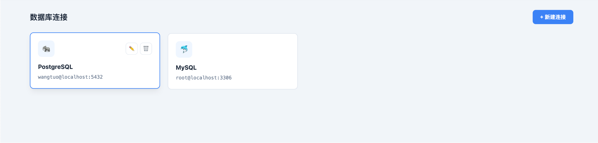
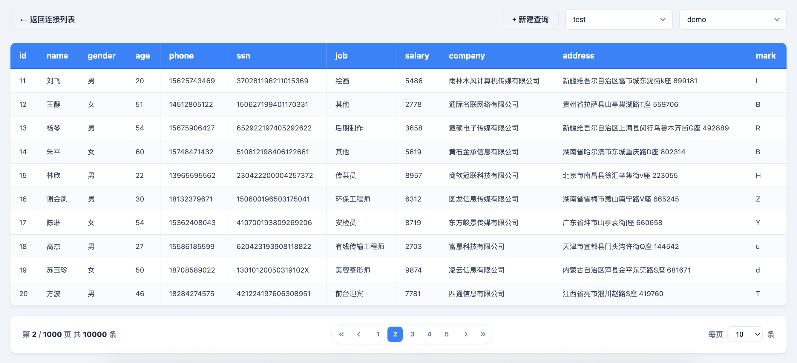
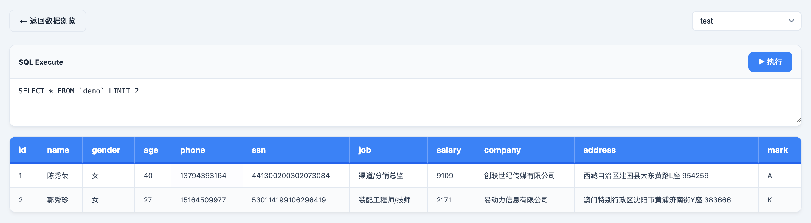

# 🗃️ db-webpage

<p align="center">
  <strong>English</strong> · <a href="README.zh-CN.md">简体中文</a>
</p>

<p align="center">
  
</p>

<p align="center">
  <a href="https://www.npmjs.com/package/db-webpage"></a>
  <a href="#"></a>
  <a href="#"></a>
  <a href="#"></a>
  <a href="#"></a>
  <a href="#"></a>
</p>

> A lightweight web-based database visualization workbench supporting **PostgreSQL**, **MySQL**, and **Redis**. Available both as a global `npm` CLI (`dbw`) and a Python FastAPI server. Manage connections, browse and edit table data, and run SQL queries or Redis commands right in your browser—no login required, ready out of the box.

---

## 🚀 Quick Start

### Option 1: Global npm Install (Recommended)

No need to clone the repo—install the `db-webpage` CLI globally via npm:

```bash
npm install -g db-webpage
```

Once installed, run from any directory:

```bash
dbw
```

This starts the server on `http://localhost:12301` and automatically opens your browser.

#### CLI Options

```bash
dbw                   # Start on default port 12301
dbw -p 8080           # Start on a custom port (or PORT=8080 dbw)
dbw -v, --version     # Show current version
dbw -h, --help        # Show help
```

---

### Option 2: Run from Source (Python FastAPI)

#### 1. Clone the repository

```bash
git clone https://github.com/markadc/db-webpage.git
cd db-webpage
```

#### 2. Start the server

```bash
chmod +x start.sh
./start.sh
```

> `start.sh` automatically creates a virtual environment, installs dependencies from `requirements.txt`, and starts the server.

#### 3. Open in browser

Visit 👉 `http://localhost:22001`

---

## ✨ Features

- 🔌 **Connection Management** — Brand-colored connection cards with type filtering, a two-step compact creation wizard, remarks, connectivity testing, and quick switching from the header pill
- 🗄️ **Multi-Database Support** — Works with **PostgreSQL**, **MySQL**, and **Redis**
- 📊 **Data Browsing & CRUD** — Pagination, column sorting, multi-condition filtering, column visibility picker, equal-width toggle & drag resizing, click-to-copy / double-click inline editing, multiline JSON & NULL modal editor, add/delete rows, and CSV/JSON export
- 📝 **Unified Query Terminal** — Execute SQL statements and Redis commands with `Cmd/Ctrl + Enter` (supports selected-text execution), result export, and query history
- 💾 **Per-Connection State Persistence** — Remembers the last used database, table, query, and UI preferences independently for each connection
- 🎨 **Focused Workbench UI** — Unified 3-tab header navigation (`Connections` / `Data` / `Query`) with a clear active connection badge

---

## 🛠️ Tech Stack

| Layer             | Node.js CLI (`db-webpage`)   | Python Source                |
| ----------------- | ---------------------------- | ---------------------------- |
| Backend           | Node.js + Express            | Python + FastAPI             |
| Frontend          | Vanilla HTML + CSS + JS      | Vanilla HTML + CSS + JS      |
| PostgreSQL Driver | `pg`                         | `psycopg2`                   |
| MySQL Driver      | `mysql2`                     | `pymysql`                    |
| Redis Driver      | `ioredis`                    | `redis`                      |

---

## 📁 Project Structure

```
db-webpage/
├── 📄 main.py              # Python FastAPI backend entry
├── 📄 requirements.txt     # Python dependencies
├── 📄 start.sh             # One-click startup script
├── 📁 templates/
│   └── 📄 index.html       # Main HTML template
├── 📁 static/
│   ├── 📁 css/style.css    # Stylesheet
│   └── 📁 js/app.js        # Frontend logic
├── 📁 db-webpage/          # npm package (db-webpage / dbw CLI)
│   ├── 📄 package.json
│   ├── 📁 src/index.js     # Express backend & CLI entry
│   └── 📄 README.md        # npm package README
├── 📁 assets/
│   ├── 🖼️ home.png
│   ├── 🖼️ view-data.png
│   └── 🖼️ exec-sql.png
├── 📄 README.md
└── 📄 README.zh-CN.md
```

---

## 📸 Usage Guide

### 🔌 Add & Switch Connections

1. Click **New Connection** in the top-right corner of the **Connections** page
2. Pick a database type (**PostgreSQL** / **MySQL** / **Redis**) with its default port pre-filled
3. Enter host, port, credentials, and optional remark, run **Test Connection**, and save
4. Click any connection card to browse data, or switch connections directly from the header pill


### 📊 Browse & Edit Data

1. Select a database and table in **Data** (Redis supports filtering by key type or `ALL`)
2. Paginate (`10 / 20 / 50 / 100 / 500`), sort columns, filter rows, toggle visible columns, or resize/equalize column widths
3. Click any cell to copy, double-click to edit inline, hover the cell's right edge for the multiline JSON / NULL modal, or hover outside a row to delete it



### 📝 Run SQL / Redis Commands

1. Switch to **Query** in the top navigation bar and choose a database (or Redis `db0`..`db15`)
2. Write SQL or Redis commands (e.g. `SELECT * FROM table_name LIMIT 10` or `KEYS *`)
3. Click **Execute** or press `Cmd/Ctrl + Enter`, then export results to CSV / JSON or revisit previous queries via **History**



---

## ⚙️ Configuration & Cache

- **npm CLI (`dbw`)**: Connection configs and per-connection state are saved in `~/.db-webpage/dbw-cache.json`
- **Python Source**: Saved in `init.json` in the project root
- **UI Preferences**: Table view toggles, query history, and page size are persisted in browser `localStorage`

> ⚠️ **Note**: Config files may contain database passwords—never commit `init.json` or `dbw-cache.json` to public repositories.

---

## ⚠️ Security Notice

- The server uses session cookies to track the active connection
- The query terminal executes arbitrary SQL / Redis commands without permission restrictions
- Intended for local development or trusted private networks only 🔒

---

## 📄 License

[MIT](LICENSE)
